# op-reason

English: [README.md](README.md)

> **非公式の道具です。** op-reason は個人の project で、1Password (AgileBits Inc.) が作ったもの・認めたもの・
> 支えるものではありません。1Password は AgileBits Inc. の商標です。

op-reason は、WSL と Windows で使う [1Password CLI](https://developer.1password.com/docs/cli/) (`op`) の wrapper です。呼ぶたびに

1. 理由が要ります: `op --reason "<なぜ>" <op の引数…>`
2. 1Password のデスクトップアプリの承認を、その 1 回の呼び出しに閉じ込めます
3. 1Password の承認の画面と一緒に、誰が・どこで・なぜ・何を打つかを出す窓を出します
4. 記録に残します (`op-reason-log`)


AI のコーディングエージェント (Claude Code など) に `op` を打たせるために作りました。承認する前に何のための依頼かが分かり、
1 回の承認が後の依頼に届かず、後からすべての呼び出しを見返せます。

op-reason は 1Password の SSH agent の前にも立てます。SSH の鍵を使うたびに、誰が何のために使うかが分かります:
[SSH の鍵: 中継](#ssh-の鍵-中継)。

## なぜ wrapper が要るのか

- **1 回の承認が後の呼び出しに漏れる。** 1Password のデスクトップアプリは、CLI の承認を `op.exe` を起こしたプロセスに
  付けます。WSL からはどの `op.exe` も、すべての端末が共有する同じ `wslhost` の子になるので、1 回の承認が後の呼び出しにも
  ほかの端末にも届きます。op-reason は呼び出しごとに Windows で新しい `op-reason.exe` を起こし、それが `op.exe` を起こして、
  終わったら sign out します。Windows から呼ぶときは、`op-reason.exe` 自身が呼び出しごとの新しいプロセスです。
- **画面は誰が頼んでいるかを言わない。** 1Password の承認の画面は、どのプロセスが頼んでも端末の名前 (「WindowsTerminal」、
  WSL からは「wslhost」) しか出しません。op-reason の窓は、呼び手 (人か、process id つきの Claude Code)・repo・branch・
  ディレクトリ・理由・コマンドを出します。
- **エージェントが何をしたかが残らない。** op-reason はすべての呼び出し・断り・見つけたことを JSON Lines で記録します。


## 仕組み


WSL からの呼び出しでは、WSL の実行ファイルが理由を確かめ、呼び手と場所を集め、Windows で新しい `op-reason.exe --run` を
起こして呼び出しを渡します。`op-reason.exe` は WSL と Windows で共通の lock を取り (承認の画面は一度に 1 つ)、作業している
画面 (前面の窓のある画面) の右上に窓を出し (窓が閉じると消える Windows の通知も出します)、あなたの stdin・stdout・stderr の
まま `op.exe` を起こし、`op` が終わると `op.exe whoami` を打ち、session があれば
`op.exe signout --all` を打ちます。Windows から呼ぶときは、`op-reason.exe` がこれを全部自分のプロセスで行います
(lock・窓の文・記録は同じです)。

`op-reason.exe` が動かないところ (署名が無いので、Smart App Control に止められることがあります) では、PowerShell の
launcher `launcher.ps1` が新しい `powershell.exe` で同じ仕事をします。WSL からの呼び出しはひとりでにそちらへ回り、Windows
では PowerShell の入口がそれを使います。詳しくは [docs/architecture/README.md](docs/architecture/README.md) (英語)。

## 要るもの

- WSL の側: Windows の interop が使える WSL 2 (Windows の `PATH` が WSL の `PATH` に入っていて、`op.exe`・`op-reason.exe`・
  `wslpath` が見つかること)
- Windows に、**設定 → 開発者 → 1Password CLI と連携** を入れた 1Password のデスクトップアプリ、1Password CLI
  (`op.exe`。たとえば `winget install AgileBits.1Password.CLI`)、op-reason の Windows の zip (WSL からの呼び出しも、その
  `op-reason.exe` で窓を出します)
- Windows PowerShell 5.1 (Windows に入っています)。回避経路 (`launcher.ps1` と PowerShell の入口) だけが使います

## 入れ方

### Release から

Release は v0.1.0 から始まります。各 Release に、x86_64 と aarch64 の Linux の静的な実行ファイルと Windows の zip が、
それぞれ SHA-256 のファイルつきであります。**WSL では両方を入れてください**: 下の Linux の実行ファイルと、
[Windows で](#windows-で) に書いた Windows の zip です (WSL からの呼び出しは、その `op-reason.exe` で窓を出します。両方とも
同じ版にしてください)。

```sh
arch=$(uname -m)   # x86_64 か aarch64
base=https://github.com/pollenjp/op-reason/releases/latest/download
curl -fLO "${base}/op-reason-${arch}-linux"
curl -fLO "${base}/op-reason-${arch}-linux.sha256"
sha256sum -c "op-reason-${arch}-linux.sha256"
install -m 755 "op-reason-${arch}-linux" ~/.local/bin/op-reason
ln -sf op-reason ~/.local/bin/op-reason-log
ln -sf op-reason ~/.local/bin/op     # 任意: `op` を wrapper にする (PATH で ~/.local/bin を先に置く)
ln -sf op-reason ~/.local/bin/op-reason-ssh   # 任意: SSH の中継を通して ssh を打つ (下)
```

WSL の実行ファイルは、`op-reason.exe` を `PATH` (WSL は Windows の `PATH` を足します) か `OPREASON_EXE` の指す所
(`/mnt/c/Users/<あなた>/AppData/Local/Programs/op-reason/op-reason.exe` のような WSL のパス) から探し、`launcher.ps1` は
その隣から探します。

### Nix で

```sh
nix profile install github:pollenjp/op-reason      # op-reason・op-reason-log・op-reason-ssh
nix profile install github:pollenjp/op-reason#op   # 同じものに `op` を足したもの
```

flake の input にもできます: `packages.<system>.default` と `packages.<system>.op`。

### Windows で

各 Release に `op-reason-windows.zip` (と `.sha256`) があります:

- `op-reason.exe`: Windows の入口です。理由・lock・窓・`op.exe`・sign out・記録まで、1 回の呼び出しを 1 つの program で
  こなします。WSL からの呼び出しの窓を出すのもこれです。
- `launcher.ps1`: WSL からの呼び出しの回避経路です。
- `powershell-entry\`: PowerShell の入口です。Smart App Control に `op-reason.exe` を止められるマシン向けです (下)。
- `SKILL.md`・README・ライセンス。

展開して 1 つのフォルダーに置き、そのフォルダーを `PATH` に足します。PowerShell で:

```powershell
$dir = "$env:LOCALAPPDATA\Programs\op-reason"    # どのフォルダーでもよい (下で PATH に足す)
$base = 'https://github.com/pollenjp/op-reason/releases/latest/download'
$zip = "$env:TEMP\op-reason-windows.zip"
Invoke-WebRequest "$base/op-reason-windows.zip" -OutFile $zip -UseBasicParsing
Invoke-WebRequest "$base/op-reason-windows.zip.sha256" -OutFile "$zip.sha256" -UseBasicParsing
$want = (Get-Content "$zip.sha256").Split(' ')[0]
if ((Get-FileHash $zip -Algorithm SHA256).Hash -ne $want) { throw 'SHA-256 が合いません' }
Expand-Archive $zip -DestinationPath $env:TEMP -Force
New-Item -ItemType Directory -Force $dir | Out-Null
Copy-Item "$env:TEMP\op-reason-windows\*" $dir -Recurse -Force
& "$dir\op-reason.exe" --version
$userPath = [Environment]::GetEnvironmentVariable('Path', 'User')
if (($userPath -split ';') -notcontains $dir) {
  [Environment]::SetEnvironmentVariable('Path', "$userPath;$dir", 'User')    # これから開く端末に効く
}
```

新しい `PATH` は、これから開く端末に効きます。WSL に効くのは `wsl --shutdown` の後です (か、`OPREASON_EXE` を入れます)。

- **`op-reason.exe` には署名がありません。** 起こす前に Windows が警告を出すことがあり (SmartScreen)、Smart App Control が
  オンだと起こすこと自体を断ることがあります (新しい版でもまた断られえます)。そのとき WSL からの呼び出しは、ひとりでに
  `launcher.ps1` へ回ります (stderr に 1 行そう出ます)。Windows では下の PowerShell の入口を使ってください。
- PowerShell・cmd.exe・ほかの program のどれからも同じように呼べ、引数はそのまま `op` に届きます (`--` も引用符なしで
  届きます)。
- **PowerShell での出力**: PowerShell は program の出力を `[Console]::OutputEncoding` で読みます。`op` の出力に ASCII 以外が
  あるときは、`$x = op-reason …` の前に `[Console]::OutputEncoding = [Text.Encoding]::UTF8` を打ってください。binary の
  出力は `op` の `--out-file` で受けてください。
- **記録**は `%LOCALAPPDATA%\op-reason\log.jsonl` です (WSL と同じ形)。`op-reason --log` で見られます。
- WSL と Windows の呼び出しは一度に 1 つずつ走ります (`op-reason.exe` と launcher が、呼び出しの間 mutex `Local\op-reason`
  を持ちます)。
- **WSL からの呼び出し**: `OPREASON_RUNNER=launcher` で `op-reason.exe` を飛ばします (Smart App Control に止められるなら、
  毎回の試しとその通知が無くなります)。`OPREASON_RUNNER=exe` なら回避しません。

#### Smart App Control に op-reason.exe を止められたら: PowerShell の入口

zip の `powershell-entry` フォルダーに、`op-reason.ps1` (入口)・`op-reason.cmd` (cmd.exe やほかの program 向けの shim)・
`launcher.ps1` と `SKILL.md` の写しがあります。Windows に入っている Windows PowerShell で動く script で、Smart App Control が
オンのマシンでも動きました。そのかわり遅く、窓が出るのは呼んでから 1〜1.5 秒ほど後です (`op-reason.exe` は数十ミリ秒。
GitHub の Windows の runner で測った値)。`<フォルダー>\powershell-entry` を `PATH` の `<フォルダー>` **より前に**足して
ください。`op-reason` で PowerShell の入口が走り、WSL はそのまま `<フォルダー>` の `op-reason.exe` と `launcher.ps1` を
見つけます (WSL からの呼び出しは何も変えなくてよい)。入口だけ別のフォルダーなのは、PowerShell が同じフォルダーの
`op-reason.exe` より `op-reason.ps1` を先に選ぶためです。

- **PowerShell から**は、`op-reason` で `op-reason.ps1` が走ります。script を許す必要があります: 既定の実行の方針
  (Restricted) は script を断り、インターネットから来たファイルには Mark of the Web が付きます。
  `Set-ExecutionPolicy -Scope CurrentUser RemoteSigned` と `Unblock-File <フォルダー>\powershell-entry\*.ps1` を打つか、代わりに
  `op-reason.cmd` を呼んでください。`-ExecutionPolicy Bypass` で動いている shell (Claude Code の tool の shell など) は、
  `op-reason.ps1` をそのまま呼べます。
- **cmd.exe やほかの program から**は `op-reason.cmd` を呼びます。cmd.exe は引数を読み直すので、空白の無い引数に `&`・`|`・
  `<`・`>`・`^`・`%` があると崩れることがあります (「BatBadBut」と呼ばれる問題)。そうした引数は引用符で囲むか、PowerShell
  から `op-reason.ps1` を呼んでください。
- **PowerShell の `--`**: 引用符で囲まない `--` は PowerShell が取ります。`op run` の子のコマンドの前には `'--'` と書いて
  ください: `op-reason --reason "…" run '--' my-command`。
- **PowerShell での出力**: `$x = op-reason …` は `op` の出力を文字 (UTF-8) として受け取ります。binary の出力は `op` の
  `--out-file` か、cmd.exe でリダイレクトした `op-reason.cmd` で受けてください。
- **記録**は同じファイルです。PowerShell の入口には記録を見るコマンドがありません:
  `Get-Content $env:LOCALAPPDATA\op-reason\log.jsonl | ConvertFrom-Json | Format-Table time, event, reason`

### fish の補完

```sh
op-reason --completion fish >~/.config/fish/completions/op.fish
op-reason --completion fish op-reason >~/.config/fish/completions/op-reason.fish
```

この補完は `op` を呼びません (fish に同梱の `op` の補完は `op completion fish` を打ち、wrapper は理由が無いので断ります)。
Nix の package は補完も入れます。

## 使い方

```sh
op --reason "staging の VM を作るのに Proxmox の API の token を読む" read "op://Private/proxmox/token"
```

- 理由は、何のために何を読む・書くかを 1 文で書きます。窓と記録に出ます。
- `--reason "<理由>"` でも `--reason=<理由>` でもよく、`--` より前ならどこに置いてもかまいません (`--` より後ろは、
  `op run` の子のコマンドのように `op` の引数です)。
- `op --version`・`op --help`・`op help <コマンド>`・`op <コマンド> --help` は理由なしで通ります (画面も窓も出ません)。
- 引数なしの `op` は wrapper の使い方を出します。
- **op-reason の窓が出ていない 1Password CLI の承認の画面は、拒否してください。**



例は symlink の `op` で書いています。`op-reason` の名前で呼んでも同じ動きで、`--help` と `--version` を単独で渡したとき
だけ wrapper 自身のものになります。Windows では `op-reason` と打ちます。

### wrapper の option (最初の引数のときだけ)

| コマンド | すること |
| --- | --- |
| `op-reason --help`・`op-reason -h` | wrapper の使い方 |
| `op-reason --version`・`op-reason -V` | op-reason の版 |
| `op-reason --skill` | AI エージェント向けの手引き (SKILL.md)。断るときの文からも案内します |
| `op-reason --completion fish [<コマンド>]` | `op` (か `<コマンド>`) の fish の補完 |
| `op-reason-log`・`op-reason --log` | 記録を見る (下) |

### 記録

```sh
op-reason-log              # 直近 1 時間に始まった呼び出し
op-reason-log --since 1d   # 30m・2h・1d…
op-reason-log --all        # 残っている記録を全部
op-reason-log --json       # 1 呼び出し 1 行の JSON (理由とコマンドを切らず、読む参照を全部)
```


記録は WSL では `${XDG_STATE_HOME:-~/.local/state}/op-reason/log.jsonl`、Windows では `%LOCALAPPDATA%\op-reason\log.jsonl`
です (1 MiB で `log.1.jsonl` へ回します。Windows の `op-reason --log` も同じ option を取ります)。`op` の出力と
token は書かず、`--session`・`--secret-key` と `name=value` の引数の値は伏せます。記録の形は
[docs/architecture/README.md](docs/architecture/README.md) にあります。

### 読む参照

窓のコマンドの行の下に、その呼び出しが読む `op://` の参照が並びます。引数の参照、`op inject` のテンプレート (`-i` の
ファイルか、stdin のテンプレート) の参照、`op run` の `--env-file` の参照です。窓には 8 件まで出し、残りは「ほか N 件」と
します。記録には全部残り、`op-reason-log` はファイルか stdin から読んだ参照の数をコマンドに添えます。

```text
コマンド: op inject -i app.env.tpl -o .env
読む参照 (10 件・app.env.tpl から):
    op://abcdefghijklmnopqrstuvwxyz/0123456789abcdefghijklmnop/password    ← リンク
    op://Private/proxmox/token
    …
    ほか 2 件
```

- vault と項目が ID (小文字と数字の 26 字。`op item get … --format json` やプライベートリンクに出る形) の参照はリンクです。
  押して離すと、1Password のアプリがその項目を開いて前に出ます。承認の画面はその手前に残り、そのまま答えられます。
  op-reason の窓はフォーカスを取りません。1Password がロック中のときは、押しても何も変わりません。名前や変数
  (`$APP_ENV`) の参照は文字のままです。
- リンクにはアカウントの ID が要ります。op-reason は承認が通った呼び出しの終わりにもともと `op whoami` を打っており、その
  JSON の出力からアカウントの ID とサインインのアドレスを読み、その 2 つだけを `%LOCALAPPDATA%\op-reason\account.json` に
  控えます。そのため **最初の呼び出しにはリンクが付きません** (窓にわけが出ます)。次からは、`op` が既定で使うアカウントの
  参照にリンクが付きます。`--account` を付けたときは、そのアカウントが前に whoami に出たもの (ID・サインインのアドレス・
  アドレスの最初の部分のどれかが合うもの) でなければなりません。ファイルを消すと、控えたアカウントを忘れます。
- WSL では stdin のテンプレートを op-reason が先に読みます (op には同じ中身を渡します)。PowerShell の入口 (Smart App
  Control のときの回り道) は stdin を読まないので、引数とファイルの参照だけが並びます。

### AI エージェント

op-reason を初めて使うエージェントは、最初に `op-reason --skill` を打ってください。理由をつけた `op` の呼び方と、
拒否・時間切れのときにすること (打ち直さず、ユーザーに聞く) が書いてあります。

### 表示の言語

既定は英語です。窓の右下の **日本語** (か **English**) を押すと切り替わります。窓はその場で変わり、1Password の承認の
画面からフォーカスを奪いません。次の呼び出しからは、窓・通知・文・`op-reason-log` がその言語になります (Windows でも
WSL でも)。選んだ言語は `%LOCALAPPDATA%\op-reason\settings.json` に残ります。消すと `OPREASON_LANG` に戻ります (WSL
では控えの `~/.local/state/op-reason/lang.json` も消すか、次の呼び出しが消すのを待ってください)。



### 終了コード

| コード | 意味 |
| --- | --- |
| `op` の終了コード | 呼び出しが走った |
| 2 | 理由が無い・理由が空・引数が Windows に渡せないほど長い・wrapper の option の誤り |
| 75 | ほかの呼び出し (WSL か Windows) の承認待ちが終わらない (lock を待つ上限を超えた) |
| 127 | `op.exe`・`op-reason.exe` (とその回避経路)・`launcher.ps1`・`powershell.exe`・`wslpath` が見つからない・起こせない、または `wslpath -w` がパスを変換できない |
| 1 | `op-reason.exe` か launcher が `op.exe` を起こせなかった |
| 129・130・143 | SIGHUP・SIGINT・SIGTERM で止められた (WSL)。Windows では Ctrl+C が 130、`op-reason.exe` のコンソールが閉じられたら 129 |

### 環境変数

| 変数 | 意味 |
| --- | --- |
| `OPREASON_LANG` | `en` か `ja`: 窓で言語を選んでいない間の、文・窓・記録の表の言語 ([表示の言語](#表示の言語))。既定は英語 (`LANG` と Windows の表示の言語は見ません) |
| `OPREASON_LOCK_WAIT` | ほかの呼び出しの承認待ちを待つ秒 (既定 90。Claude Code の Bash の既定の時間切れ 120 秒より短い) |
| `OPREASON_OP_EXE` | `op.exe` のパス (既定は `PATH` の `op.exe`) |
| `OPREASON_EXE` | WSL: `op-reason.exe` のパス (既定は `PATH` の `op-reason.exe`)。`launcher.ps1` はそのフォルダーから探します |
| `OPREASON_RUNNER` | WSL: `auto` (既定。`op-reason.exe` を起こし、それが呼び出しを始めなかったときだけ `launcher.ps1`)・`exe` (launcher を使わない)・`launcher` (exe を使わない) |
| `OPREASON_POWERSHELL` | WSL: launcher を起こす `powershell.exe` のコマンド (既定 `powershell.exe`) |
| `OP_SERVICE_ACCOUNT_TOKEN`、`OP_CONNECT_HOST` と `OP_CONNECT_TOKEN` | service account か Connect: `op` はデスクトップアプリなしで走り (窓も画面も無し)、token を受け取ります。デスクトップの呼び出しには渡しません |
| `HERDR_ENV`・`HERDR_WORKSPACE_ID`・`HERDR_PANE_ID` | [herdr](https://herdr.dev/) の中では、窓に workspace と pane を出します (任意) |
| `OPREASON_SSH_REASON` | [SSH の中継](#ssh-の鍵-中継) を通す ssh の呼び出しの理由 (Windows の client と、WSL の `op-reason-ssh`) |
| `OPREASON_SSH_EXE` | WSL: `op-reason-ssh` が起こす `ssh.exe` (既定は `PATH` の `ssh.exe`) |
| `OPREASON_SSH_CALL` | `op-reason-ssh` が中継のために置く (WSL からの呼び出しの事実)。自分では置きません |

接頭辞が `OP_` でなく `OPREASON_` なのは、1Password CLI 自身が `OP_…` の変数を多く読むためです。

## SSH の鍵: 中継

`op-reason.exe --ssh-agent` は、1Password の SSH agent の前に立つ中継です。裏で動き続け、自分のパイプ
`\\.\pipe\op-reason-ssh-agent` で SSH agent の protocol を受け、どの依頼もそのまま 1Password の agent
(`\\.\pipe\openssh-ssh-agent`) へ渡します。決めるのを待つのは署名だけで、鍵の一覧などはすぐに通します。
設計: [docs/superpowers/specs/2026-11-17-ssh-relay-design.md](docs/superpowers/specs/2026-11-17-ssh-relay-design.md)。

なぜ: 1Password の SSH の確認の画面には、アプリと鍵しか出ず、呼び手・行き先・理由が出ません。端末で打った ssh なら、
アプリは端末のプログラムです (Windows からも WSL からも)。設定「新しいものごとに承認を求める」が「アプリケーションおよび
ターミナルセッション」なら、1 度の承認で、1Password がロックするまでそのターミナルセッションの後の署名がすべて通り、
「アプリケーション」ならその端末のプログラムの後の署名がすべて通ります。人が 1 度許可したあとは、同じ端末のエージェントが
画面なしで鍵を使えます。「リクエスト」にすると署名のたびに確認が出て、WSL の ansible (タスクとホストごとに新しい接続) では
1 回の実行で何十回も出ます。

### 2 つのモード

| モード | どこで決めるか | 1Password の設定 |
| --- | --- | --- |
| `per-call` (既定) | op-reason の窓で、呼び出しごとに 1 回: **この呼び出しを許可**・**拒否**、端末で打った `ssh`・`git`・`scp`・`sftp`・`rsync`・`ansible` なら **このターミナルを 60 分許可** も。1Password は、ロックするまでに中継を 1 回承認するだけ | 「アプリケーションおよびターミナルセッション」(勧める)。「アプリケーション」でも動くが、中継と同じ端末のプログラムから 1Password に直につなぐ client を、1Password が確認しなくなる ([止められないもの](#止められないもの)) |
| `show-only` | 署名のたびに 1Password の画面で。op-reason の窓は、その横に誰が何のためにを出す | 「リクエスト」 |

**呼び出し** は、起点の process・鍵・理由の組です。起点は、Claude Code の tool の呼び出し・端末で打ったコマンド (`git push`・
`ansible-playbook`・`ssh`)・自分で ssh を起こすプログラムのどれかで、WSL では `op-reason-ssh` が Linux の側で見つけます。
許可した呼び出しの後の署名は窓なしで通り、左上のトーストに出ます ([窓・トースト・通知](#窓トースト通知)。ansible の fork は
1 つの答えを待ちます)。拒否した呼び出しの後の署名はすぐに断ります。答えは、起点の process が終わるか (WSL の起点は時間切れだけ)、60 分たつか (`--time-limit`)、中継が止まるまで効き、
メモリーにだけ置きます。ターミナルの答えが効くのは、その shell で後から打った ssh の仲間のコマンドで、動き続けるプログラム
(端末のプログラム・ほかの AI エージェントのコマンドラインの道具) には効きません。リモートのホストから転送で戻ってきた依頼
(`ssh -A`) は、1 つずつが別の呼び出しです。中継はそれを `session-bind@openssh.com` で見分けます。OpenSSH が送るのは 8.9 から
なので、それより古い `ssh.exe` では署名のたびに聞きます。

窓には、誰が (Claude Code・人・プログラム。WSL からならあわせて herdr の workspace と pane・ディストリビューション・
repository・branch)、起点の process、理由 (無ければ「理由なし」)、ssh のコマンド、行き先とそのホストの鍵、署名の用途
(どのユーザーとしてのログインか、`git` のような SSHSIG の namespace か)、1Password での鍵の名前が出ます。答えるのはクリック
(ボタンの上で押して離す) だけです。窓はフォーカスを取らず、既定のボタンもないので、ほかで打ったキーが窓に答えることは
ありません。60 秒答えが無ければ、その署名を断り、何も覚えません。

> **per-call では決まりが変わります。** op-reason のほかの所では、決めるのは 1Password の画面で、op-reason の窓は事実を
> 見せるだけです。per-call では op-reason の窓で決めます。1Password には呼び出しの区別が付かず、署名ごとに聞かせるのは
> 使えないためです。show-only は前の決まりのままです。

### 窓・トースト・通知

op-reason が画面に出すものは 3 つで、それぞれの場所に出ます
([設計](docs/superpowers/specs/2026-11-18-pass-toasts-design.md))。

| もの | 場所 | 消えるとき |
| --- | --- | --- |
| op-reason の窓: 聞く (per-call)、または 1Password が確認している間に誰が・なぜを出す | 前面の窓のある画面の右上 | 依頼に答えが出たとき |
| トースト: 窓を出さずに通った署名 (per-call) | その画面の左上 | その呼び出しの最後の署名から 4 秒後 |
| 窓に付く Windows の通知 | 右下 (Windows の通知) | 窓と一緒に。窓が答えを待ったまま時間切れになったときは残る |

- **トースト**: 前の答え (**この呼び出しを許可**・**このターミナルを 60 分許可**) で通った署名は、カードを 4 秒出して
  薄れて消えます。中身は `通過 · <呼び手>`、ssh のコマンドと接続先、通った訳 (この呼び出しの許可・ターミナルの許可) と
  理由です。同じ呼び出しの署名は 1 枚にまとめ、数 (×N) と最後の接続先を出して 4 秒を数え直します。ほかの呼び出しは
  1 枚ずつ一番上に入り、同時に 3 枚まで (4 枚目が来たら一番古いものをすぐ消す)。トーストはフォーカスを取らず、クリックを
  下の窓へ通し、音を鳴らさず、通知センターにも入りません。Windows のアニメーション効果を切っていれば、ずれたり薄れたり
  せずに出て消えます。
- **窓**は、作業している画面 (前面の窓のある画面。前面の窓が無ければ主画面) に出て、出た後は動きません。`op` の呼び出しの
  窓も同じです。
- **通知**は窓と一緒に消えるので、通知センターに溜まりません。per-call の窓が時間切れで閉じたときは、答えなかった依頼の
  印として残ります。1 回だけの知らせ (1Password が確認しなかった・1Password が答えなかった・中継に親の process が無い) は
  残ります。


🌐 [HTML 版: SSH の中継の窓・トースト・通知](docs/html/relay-screens.html#ja)

### 起こし方

```powershell
op-reason.exe --ssh-agent                      # per-call。Ctrl+C かログオフまで動く
op-reason.exe --ssh-agent --mode show-only
op-reason.exe --ssh-agent --status             # パイプで中継が答えれば 0 (とその process id)
```

- **ログオンのときにタスク スケジューラーのタスクから起こしてください** (隠して、落ちたら起こし直す)。すぐ終わる script から
  起こさないでください。1Password は、親の process が終わった中継の依頼に 60 秒答えません。中継は、親が無いとき・
  終わったときに toast と記録でそう知らせます。自分だけのコンソール (タスク・ダブルクリック) ではコンソールの窓を残しません。
- 中継はログオン セッションに 1 つです。option: `--mode per-call|show-only`・`--pipe <名前>`・`--upstream <名前>`・
  `--time-limit <数>[s|m|h]` (既定 60m)・`--answer-wait <数>[s|m]` (窓がクリックを待つ長さ。既定 60s)。
- 窓を出している間、中継は op-reason の lock を持ちます。中継の窓と 1Password の画面は、`op` の呼び出しのものと混ざらずに
  組で出ます。

### ssh を中継へ向ける

- **Windows**: Windows の OpenSSH なら `SSH_AUTH_SOCK` に `\\.\pipe\op-reason-ssh-agent` を置くか、`~/.ssh/config` に
  `IdentityAgent \\\\.\pipe\op-reason-ssh-agent` (OpenSSH は設定と `-o` の `\\` を `\` 1 つと読むので、先頭の 2 つを重ねます)。
  理由は `OPREASON_SSH_REASON` で渡します: `$env:OPREASON_SSH_REASON = "ログインの修正を push する"; git push`。
  Git for Windows は自前の ssh を使い、それはパイプに届きません: `GIT_SSH` (か `core.sshCommand`) を Windows の OpenSSH の
  `ssh.exe` (`C:\Windows\System32\OpenSSH\ssh.exe` や `C:\Program Files\OpenSSH\ssh.exe`) にします。
- **WSL**: `ssh.exe` の代わりに `op-reason-ssh` (その名前の WSL の実行ファイル) を打ちます。たとえば
  `GIT_SSH_COMMAND=op-reason-ssh`、ansible なら `ansible_ssh_executable=op-reason-ssh`。理由は `OPREASON_SSH_REASON` です。
  `op-reason-ssh` は Linux の側で呼び出しの起点を見つけ、`op` と同じように呼び手 (Claude Code・herdr・repository) を集め、
  ディストリビューションと理由とあわせて `OPREASON_SSH_CALL` に入れて (`WSLENV` を通して) 中継に渡し、引数・stdin・
  stdout・stderr をそのままに `ssh.exe` を起こします (`ssh.exe` は Windows の `~/.ssh/config` を読むので、上の `IdentityAgent`
  の行は WSL にも効きます)。集められなくても `ssh.exe` は起こします (そのとき中継は署名ごとに聞きます)。

### 記録

署名は 1 つずつ `%LOCALAPPDATA%\op-reason\ssh-log.jsonl` に残ります (4 MiB で回し、古いものを 2 つ残す)。署名した中身と
署名そのものは残しません。`op-reason.exe --log` は、`op` の呼び出しの間に 1 行ずつ並べます:

```text
時刻      結果      秒   呼び手           理由                      コマンド
09:00:12  SSH 許可  2.5  Claude デプロイ …  ログインの修正を push する  ssh.exe git@github.com "git-receive-pack 'me/r.git'"
09:00:13  SSH 通過  0.1  Claude デプロイ …  ログインの修正を push する  ssh.exe git@github.com "git-receive-pack 'me/r.git'"
```

### 止められないもの

- 自分のアカウントのプログラムが、中継をくぐろうとすること: `OPREASON_SSH_CALL` を偽る・許可した起点の下で動く・クリックを
  送る。`op` と同じく、op-reason が見せるのは事実で、証明ではありません。
- 1Password のパイプに直につなぐ client。1Password が確認するのは、ロックしてからまだ承認していないアプリ
  (「アプリケーションおよびターミナルセッション」なら、アプリとターミナルセッションの組) からの依頼で、1Password がアプリと
  見るのは client ではなく、それを動かしている端末のプログラムです。そのため「アプリケーション」では、中継を承認したあと、
  中継と同じ端末のプログラムから直につなぐ client は確認なしに通ります。「アプリケーションおよびターミナルセッション」なら、
  別のターミナルセッションの client には確認が出ます。**op-reason の窓が出ていない 1Password の SSH の確認が、その印です。**
- ほかの AI エージェントのコマンドラインの道具は、人 (端末で打った) かプログラムとして見えます。見分けるのは Claude Code の
  tool の呼び出しだけです。その依頼もクリックを待ち、ターミナルの答えは効きません。
- WSL からの呼び出しは、`ssh.exe` の親 (`wsl.exe`・`wslhost.exe`・`C:\Windows\System32\bash.exe`) で見分けます。
  ディストリビューション自身の起動プログラム (`ubuntu.exe` など) で始めた WSL では `ssh.exe` の親が別になることがあり、
  そのとき中継は Windows のプログラムとして扱います (手で確かめること: [docs/manual-verification.ja.md](docs/manual-verification.ja.md))。
- Smart App Control が `op-reason.exe` を止める所では、中継はありません (PowerShell の代わりもありません)。Git Bash の
  `ssh` (MSYS2) は Windows のパイプを使いません。`op-ssh-sign` による git の commit の署名は 1Password のアプリに直に話し
  (`op-ssh-sign-wsl.exe` で確かめた)、中継の外にあります。

## 知っておくこと

- **`signout --all` は CLI の session をすべて閉じます。** この呼び出しのものだけでなく、同じときにほかの端末のタブで手で
  打った `op` のものも閉じます。op-reason の呼び出しどうしは一度に 1 つなので、互いの session は閉じません (パイプで
  つないだ 2 つの呼び出しは、送り手が session に触らない形で扱います)。
- **一度に 1 つ。** ある呼び出しが承認を待つ間、次の呼び出しは `OPREASON_LOCK_WAIT` 秒まで待ち、超えたら 75 で終わります。
  `op … | op …` は動きます (受け手が、待つ前に送り手の出力を読み切ります)。
- **長く動く `op run`。** lock と窓は `op` が終わるまで残ります。server を `op run` で起こさず、値を解いたら `op` を終わらせて
  ください。
- **呼び出しを止める道具。** 承認の画面が出ている間に道具が `op-reason` を止めると (コマンドの時間切れなど)、窓が消えて
  画面だけが残ることがあります。拒否してください。許可してしまったら 1Password をロックしてください (承認は、終わった
  プロセスに付いたまま 1Password の 10 分の期限まで残ります)。`op-reason.exe` そのものが止められたときは、`op.exe` と
  その画面も一緒に終わります (Job Object)。WSL から止めたときにそれが `op-reason.exe` へどう届くかは、まだ手で確かめていま
  せん ([docs/manual-verification.ja.md](docs/manual-verification.ja.md))。
- **共有の承認。** op-reason は各呼び出しの前と後に、WSL から直に `op.exe whoami` を打ちます。通れば、どの端末からも使える
  承認がある (窓の出ていない画面を許可したか、道具が `op.exe` を直に打った) ので、sign out して記録し、通知を出します。
- **Windows の Ctrl+C**: `op-reason.exe` は `op` を止め、sign out し、`中断` と記録して 130 で終わります。PowerShell の入口
  では、Ctrl+C で止めた呼び出しは、PowerShell が入口の後始末を走らせれば `中断` (終了コード 130) として記録します。
  PowerShell のプロセス自身の終了コードは PowerShell が決めます。
- **Windows のパイプ**: Windows では op-reason どうしのパイプ (`op-reason … | op-reason …`) を見分けません。2 つ目の呼び出しは
  `OPREASON_LOCK_WAIT` が尽きるまで lock を待つことがあります。1 つ目の出力は変数に入れてください。
- WSL の見張りは Windows の lock の外で `op.exe signout --all` を打つので、共有の承認を見つけたときに、その時動いている
  Windows の呼び出しの session を閉じることがあります (まれ)。
- まだ確かめていないこと: `--all` の無い `op signout` が、1 つのプロセスの session だけを閉じるか。
- **承認の画面が出ている間のリンク**は、1Password のアプリで項目を開き、アプリが前に出ます。承認の画面もアプリのものです。
  アプリが 2 つをどう見せるかは、まだ手で確かめていません ([docs/manual-verification.ja.md](docs/manual-verification.ja.md))。

## 開発

```sh
nix develop path:./nix                       # Rust・pwsh・fish・jq・shellcheck・shfmt・python3
cargo test --workspace                       # 単体テストと呼び出しの表
cargo build && bash tests/run-all.sh         # 偽の op-reason.exe・powershell.exe・op.exe での黒箱のテスト
python3 docs/images/make_readme_svgs.py      # README の動く図 (docs/images/*.svg)
# op-reason.exe は別の Cargo workspace: crates/op-reason-win で、Windows なら `cargo build -p fake-op -p fake-ssh` のあと
# `cargo test --workspace` (Linux では Windows に依らない部分だけ)
```

- README の動く図は `docs/images/make_readme_svgs.py` (標準ライブラリだけの Python) で作ります。文言や配置を
  直すときは SVG ではなく script を直し、devShell の中で流して作り直してください。図の文は op-reason の文 (窓・断り・
  記録の表・中継の窓とトースト) の写しです。CI が流す `--check` は、SVG が script の出力と違うときと、写した文や時間が
  Rust のソースか中継のトーストの HTML 版 (`docs/html/relay-screens.html`) から消えたときに落ちます。
- 本物の 1Password で確かめる手順: [docs/manual-verification.ja.md](docs/manual-verification.ja.md)
- 設計: [docs/superpowers/specs/2026-11-15-op-reason-design.md](docs/superpowers/specs/2026-11-15-op-reason-design.md) (英語)。
  `op-reason.exe` は [docs/superpowers/specs/2026-11-15-windows-exe-design.md](docs/superpowers/specs/2026-11-15-windows-exe-design.md) (英語)、
  WSL からの呼び出しを exe に通す形は [docs/superpowers/specs/2026-11-15-wsl-through-exe-design.md](docs/superpowers/specs/2026-11-15-wsl-through-exe-design.md) (英語)、
  窓の表示の言語は [docs/superpowers/specs/2026-11-15-language-toggle-design.md](docs/superpowers/specs/2026-11-15-language-toggle-design.md) (英語)、
  SSH の中継は [docs/superpowers/specs/2026-11-17-ssh-relay-design.md](docs/superpowers/specs/2026-11-17-ssh-relay-design.md) (英語)、
  中継のトースト・窓の出る画面・通知は [docs/superpowers/specs/2026-11-18-pass-toasts-design.md](docs/superpowers/specs/2026-11-18-pass-toasts-design.md) (英語)
- 版ごとに変わったこと: [CHANGELOG.md](CHANGELOG.md) (英語)
- どこに何があるか: [docs/README.md](docs/README.md)

## ライセンス

[Apache License, Version 2.0](LICENSE-APACHE) と [MIT license](LICENSE-MIT) のどちらかを選んで使えます。
