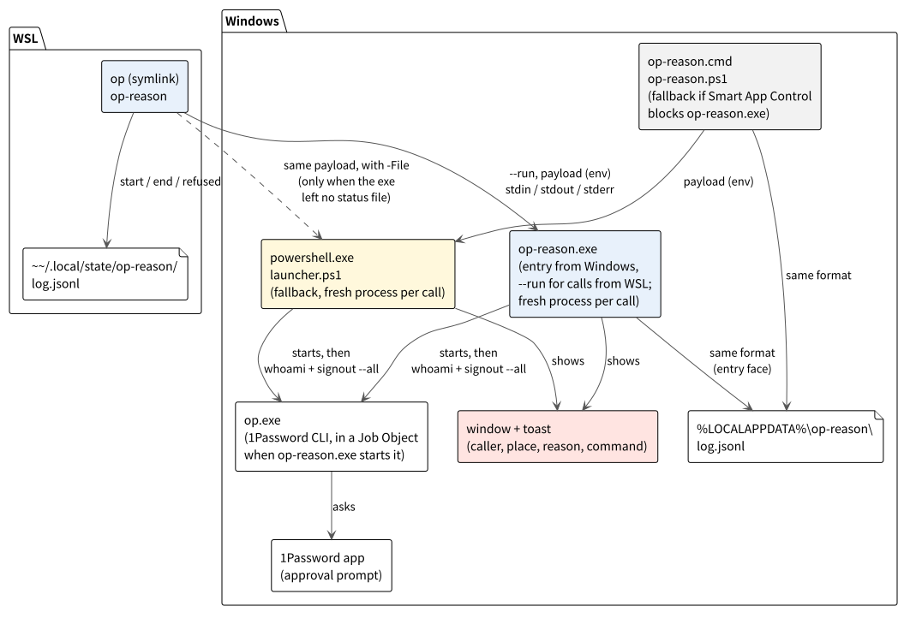

# op-reason

日本語版は [README.ja.md](README.ja.md) にあります。

> **Unofficial.** op-reason is an independent project. It is not made, endorsed or supported by 1Password
> (AgileBits Inc.). 1Password is a trademark of AgileBits Inc.

op-reason is a wrapper for the [1Password CLI](https://developer.1password.com/docs/cli/) (`op`) on WSL and Windows.
Every call

1. must give a reason: `op --reason "<why>" <op arguments…>`,
2. gets its own approval from the 1Password desktop app, confined to that one call,
3. shows a window with who calls, where, why and the command, next to 1Password's approval prompt, and
4. is recorded in a log (`op-reason-log`).

![Animation: in a WSL terminal, Claude Code runs op --reason "read the Proxmox API token to create the staging VM" read "op://Private/proxmox/token". op-reason's window opens at the top right of the screen with the time, the caller (Claude Code and its process id), the place, the reason and the command, and the 1Password approval prompt (drawn as a plain box) opens in the middle of the screen. After a click on Approve, op prints the value (hidden here), op-reason signs out and its window closes, and op-reason-log shows the call as one line: approved, by Claude, with the reason and the command.](docs/images/readme-1-call.en.svg)

It was written for AI coding agents (such as Claude Code) that run `op` on your behalf: you see what each request is
for before you approve it, one approval never covers later requests, and you can review every call afterwards.

## Why a wrapper

- **One approval leaks to later calls.** The 1Password desktop app binds a CLI approval to the process that started
  `op.exe`. From WSL every `op.exe` is a child of the same `wslhost` that all terminals share, so a single approval
  reaches later calls and other terminals. For every call op-reason starts a fresh `op-reason.exe` on Windows, which
  starts `op.exe` and signs out at the end. Called from Windows, `op-reason.exe` is itself the fresh process of the
  call.
- **The prompt does not say who asks.** 1Password's prompt names only the terminal ("WindowsTerminal", or "wslhost"
  from WSL), whatever process asked. op-reason's window shows the caller (a person or Claude Code with its process id),
  the repository, branch and directory, the reason and the command.
- **Nothing records what agents did.** op-reason logs every call, refusal and finding as JSON Lines.


## How it works



For every call from WSL, the WSL executable checks the reason, collects the caller and the place, and starts a fresh
`op-reason.exe --run` on Windows with the call. `op-reason.exe` takes a lock shared by WSL and Windows (one approval
prompt at a time), shows the window at the top right of the screen, starts `op.exe` with your stdin, stdout and
stderr, and when `op` exits runs `op.exe whoami` and, if a session is open, `op.exe signout --all`. Called from
Windows, `op-reason.exe` does all of this in its own process, with the same lock, window texts and log.

Where `op-reason.exe` cannot run (Smart App Control may block it: it is not signed), the PowerShell launcher
`launcher.ps1` does the same job in a fresh `powershell.exe`: calls from WSL fall back to it by themselves, and the
PowerShell entry uses it on Windows. Details: [docs/architecture/README.md](docs/architecture/README.md).

## Requirements

- For the WSL side: WSL 2 with Windows interop (the Windows `PATH` is part of the WSL `PATH`, so `op.exe`,
  `op-reason.exe` and `wslpath` are found)
- On Windows: the 1Password desktop app with **Settings → Developer → Integrate with 1Password CLI** turned on, the
  1Password CLI (`op.exe`, for example `winget install AgileBits.1Password.CLI`), and op-reason's Windows zip (also
  for calls from WSL: they show their window through its `op-reason.exe`)
- Windows PowerShell 5.1 (part of Windows), only for the fallback (`launcher.ps1` and the PowerShell entry)

## Install

### From a release

Releases start with v0.1.0. Each release has static Linux executables for x86_64 and aarch64 and the Windows zip,
each with a SHA-256 file. **On WSL, install both**: the Linux executable below, and the Windows zip as described under
[On Windows](#on-windows) (calls from WSL show their window through its `op-reason.exe`; use the same release on both
sides).

```sh
arch=$(uname -m)   # x86_64 or aarch64
base=https://github.com/pollenjp/op-reason/releases/latest/download
curl -fLO "${base}/op-reason-${arch}-linux"
curl -fLO "${base}/op-reason-${arch}-linux.sha256"
sha256sum -c "op-reason-${arch}-linux.sha256"
install -m 755 "op-reason-${arch}-linux" ~/.local/bin/op-reason
ln -sf op-reason ~/.local/bin/op-reason-log
ln -sf op-reason ~/.local/bin/op     # optional: make `op` the wrapper (~/.local/bin must come first in PATH)
```

The WSL executable finds `op-reason.exe` in the `PATH` (WSL adds the Windows `PATH`) or where `OPREASON_EXE` points
(a WSL path such as `/mnt/c/Users/<you>/AppData/Local/Programs/op-reason/op-reason.exe`), and `launcher.ps1` next to
it.

### With Nix

```sh
nix profile install github:pollenjp/op-reason      # op-reason, op-reason-log
nix profile install github:pollenjp/op-reason#op   # the same, plus `op`
```

The flake also works as an input: `packages.<system>.default` and `packages.<system>.op`.

### On Windows

Each release has `op-reason-windows.zip` (with a `.sha256` file):

- `op-reason.exe`: the Windows entry, one program that does the whole call itself (the reason, the lock, the window,
  `op.exe`, the sign-out and the log), and the program that shows the window of calls from WSL;
- `launcher.ps1`: the fallback of calls from WSL;
- `powershell-entry\`: the PowerShell entry, for machines where Smart App Control blocks `op-reason.exe` (below);
- `SKILL.md`, the READMEs and the licenses.

Unpack it into one folder and add the folder to your `PATH`. In PowerShell:

```powershell
$dir = "$env:LOCALAPPDATA\Programs\op-reason"    # any folder; it is added to your PATH below
$base = 'https://github.com/pollenjp/op-reason/releases/latest/download'
$zip = "$env:TEMP\op-reason-windows.zip"
Invoke-WebRequest "$base/op-reason-windows.zip" -OutFile $zip -UseBasicParsing
Invoke-WebRequest "$base/op-reason-windows.zip.sha256" -OutFile "$zip.sha256" -UseBasicParsing
$want = (Get-Content "$zip.sha256").Split(' ')[0]
if ((Get-FileHash $zip -Algorithm SHA256).Hash -ne $want) { throw 'the SHA-256 does not match' }
Expand-Archive $zip -DestinationPath $env:TEMP -Force
New-Item -ItemType Directory -Force $dir | Out-Null
Copy-Item "$env:TEMP\op-reason-windows\*" $dir -Recurse -Force
& "$dir\op-reason.exe" --version
$userPath = [Environment]::GetEnvironmentVariable('Path', 'User')
if (($userPath -split ';') -notcontains $dir) {
  [Environment]::SetEnvironmentVariable('Path', "$userPath;$dir", 'User')    # for terminals started from now on
}
```

Terminals started afterwards see the new `PATH`; WSL sees it after `wsl --shutdown` (or set `OPREASON_EXE`).

- **`op-reason.exe` is not signed.** Windows may warn before it starts (SmartScreen), and with Smart App Control on it
  may refuse to start it at all, again for each new version. Calls from WSL then fall back to `launcher.ps1` by
  themselves (one line on stderr says so); on Windows use the PowerShell entry below.
- It is called the same way from PowerShell, cmd.exe and other programs, and the arguments reach `op` as given (`--`
  needs no quotes).
- **Output in PowerShell**: PowerShell decodes a program's output with `[Console]::OutputEncoding`. When `op`'s output
  is not ASCII, run `[Console]::OutputEncoding = [Text.Encoding]::UTF8` before `$x = op-reason …`. For binary output
  use `op`'s `--out-file`.
- **The log** is `%LOCALAPPDATA%\op-reason\log.jsonl` (the same format as on WSL); `op-reason --log` shows it.
- Calls from WSL and from Windows run one at a time: `op-reason.exe` and the launcher hold the mutex `Local\op-reason`
  while a call runs.
- **Calls from WSL**: `OPREASON_RUNNER=launcher` makes them skip `op-reason.exe` (where Smart App Control blocks it,
  this saves the attempt and its notice on every call); `OPREASON_RUNNER=exe` never falls back.

#### If Smart App Control blocks op-reason.exe: the PowerShell entry

The zip's `powershell-entry` folder holds `op-reason.ps1` (the entry), `op-reason.cmd` (a shim for cmd.exe and other
programs) and copies of `launcher.ps1` and `SKILL.md`. These are scripts for Windows PowerShell, which comes with
Windows, and they ran on a machine with Smart App Control on. They are slower: the window appears one to one and a
half seconds after the call, against a few tens of milliseconds for `op-reason.exe` (measured on GitHub's Windows
runners). Add `<folder>\powershell-entry` to your `PATH` **in front of** `<folder>`: `op-reason` then runs the
PowerShell entry, and WSL still finds `op-reason.exe` and `launcher.ps1` in `<folder>` (calls from WSL need no change).
The entry has a folder of its own because PowerShell prefers `op-reason.ps1` to `op-reason.exe` in one folder.

- **From PowerShell**, `op-reason` runs `op-reason.ps1`. Scripts must be allowed: the default execution policy
  (Restricted) refuses them, and files from the internet carry the Mark of the Web. Either
  `Set-ExecutionPolicy -Scope CurrentUser RemoteSigned` and `Unblock-File <folder>\powershell-entry\*.ps1`, or call `op-reason.cmd`
  instead. Shells that already run with `-ExecutionPolicy Bypass` (such as Claude Code's tool shell) can call
  `op-reason.ps1` directly.
- **From cmd.exe and other programs**, call `op-reason.cmd`. cmd.exe re-parses the arguments: an argument without
  spaces that contains `&`, `|`, `<`, `>`, `^` or `%` can break (the problem known as "BatBadBut"). Quote such
  arguments, or call `op-reason.ps1` through PowerShell.
- **`--` in PowerShell**: PowerShell takes an unquoted `--` for itself. Write `'--'` for the child command of
  `op run`: `op-reason --reason "…" run '--' my-command`.
- **Output in PowerShell**: `$x = op-reason …` captures `op`'s output as text (UTF-8). For binary output use
  `op`'s `--out-file`, or `op-reason.cmd` with a redirection in cmd.exe.
- **The log** is the same file. The PowerShell entry has no log viewer:
  `Get-Content $env:LOCALAPPDATA\op-reason\log.jsonl | ConvertFrom-Json | Format-Table time, event, reason`.

### fish completion

```sh
op-reason --completion fish >~/.config/fish/completions/op.fish
op-reason --completion fish op-reason >~/.config/fish/completions/op-reason.fish
```

The completion never runs `op` (fish's own `op` completion runs `op completion fish`, which the wrapper refuses without
a reason). The Nix packages install it already.

## Usage

```sh
op --reason "read the Proxmox API token to create the staging VM" read "op://Private/proxmox/token"
```

- Write the reason as one sentence: what for, and what you read or write. It appears in the window and the log.
- `--reason "<reason>"` and `--reason=<reason>` both work, anywhere before `--` (after `--`, the arguments belong to
  `op`, such as the child command of `op run`).
- `op --version`, `op --help`, `op help <command>` and `op <command> --help` need no reason (no prompt, no window).
- `op` without arguments prints the wrapper's usage.
- **Deny any 1Password CLI approval prompt that comes without the op-reason window.**


The examples use `op`, the symlink. Called as `op-reason`, the wrapper behaves the same, except that `--help` and
`--version` alone are the wrapper's own. On Windows, type `op-reason`.

### Wrapper options (first argument only)

| Command | What it does |
| --- | --- |
| `op-reason --help`, `op-reason -h` | the wrapper's usage |
| `op-reason --version`, `op-reason -V` | op-reason's version |
| `op-reason --skill` | a guide for AI agents (a SKILL.md file); refusals point agents to it |
| `op-reason --completion fish [<command>]` | the fish completion for `op` (or `<command>`) |
| `op-reason-log`, `op-reason --log` | the log viewer (below) |

### The log

```sh
op-reason-log              # calls that started in the last hour
op-reason-log --since 1d   # 30m, 2h, 1d, …
op-reason-log --all        # everything kept
op-reason-log --json       # one JSON object per call, reason and command not cut
```



The log is `${XDG_STATE_HOME:-~/.local/state}/op-reason/log.jsonl` on WSL and `%LOCALAPPDATA%\op-reason\log.jsonl` on
Windows, where `op-reason --log` takes the same options (renamed to `log.1.jsonl` at 1 MiB). It never holds
`op`'s output or tokens; values of `--session`, `--secret-key` and `name=value` arguments are masked. The record format
is described in [docs/architecture/README.md](docs/architecture/README.md).

### AI agents

Agents that have not seen op-reason before should run `op-reason --skill` once: it explains how to call `op` with a
reason and what to do when a call is denied or times out (do not retry; ask the user).

### Language

English by default. Click **日本語** (or **English**) at the bottom right of the window to switch: the window changes
at once, without taking the focus from the 1Password prompt, and every later call uses that language for the window,
the notification, the messages and `op-reason-log`, on Windows and on WSL. The choice is kept in
`%LOCALAPPDATA%\op-reason\settings.json`; delete it to go back to `OPREASON_LANG` (on WSL, also delete the copy
`~/.local/state/op-reason/lang.json`, or let the next call remove it).


### Exit codes

| Code | Meaning |
| --- | --- |
| `op`'s code | the call ran |
| 2 | no reason, an empty reason, arguments too long for Windows, or a wrong wrapper option |
| 75 | another call (WSL or Windows) is still waiting for its approval (the lock wait timed out) |
| 127 | `op.exe`, `op-reason.exe` (and its fallback), `launcher.ps1`, `powershell.exe` or `wslpath` was not found, or could not be started, or `wslpath -w` could not convert a path |
| 1 | `op-reason.exe` or the launcher could not start `op.exe` |
| 129, 130, 143 | stopped by SIGHUP, SIGINT, SIGTERM (WSL); on Windows, 130 for Ctrl+C and 129 when the console of `op-reason.exe` closes |

### Environment variables

| Variable | Meaning |
| --- | --- |
| `OPREASON_LANG` | `en` or `ja`: language of messages, the window and the log viewer while none was chosen in the window ([Language](#language)). Default: English (`LANG` and the Windows display language do not count) |
| `OPREASON_LOCK_WAIT` | seconds to wait for another call's approval (default 90, below the 120-second default timeout of Claude Code's Bash tool) |
| `OPREASON_OP_EXE` | path of `op.exe` (default: `op.exe` in `PATH`) |
| `OPREASON_EXE` | WSL: path of `op-reason.exe` (default: `op-reason.exe` in `PATH`); `launcher.ps1` is looked for in its folder |
| `OPREASON_RUNNER` | WSL: `auto` (default: `op-reason.exe`, and `launcher.ps1` when the exe did not start the call), `exe` (never the launcher) or `launcher` (never the exe) |
| `OPREASON_POWERSHELL` | WSL: the `powershell.exe` command for the launcher (default `powershell.exe`) |
| `OP_SERVICE_ACCOUNT_TOKEN`, `OP_CONNECT_HOST` + `OP_CONNECT_TOKEN` | service account or Connect: `op` runs without the desktop app (no window, no prompt) and gets the token; desktop calls never get these variables |
| `HERDR_ENV`, `HERDR_WORKSPACE_ID`, `HERDR_PANE_ID` | inside [herdr](https://herdr.dev/), the window shows the workspace and pane (optional) |

The prefix is `OPREASON_`, not `OP_`: the 1Password CLI reads many `OP_…` variables of its own.

## Things to know

- **`signout --all` closes every CLI session**, not only the one of this call: also an `op` that you typed by hand in
  another terminal tab at the same time. op-reason calls run one at a time, so they do not close each other's
  sessions (two calls connected by a pipe are handled: the sender leaves the sessions alone).
- **One call at a time.** While one call waits for its approval, the next waits up to `OPREASON_LOCK_WAIT` seconds and
  then gives up with exit 75. `op … | op …` works: the receiver reads the sender's output before waiting.
- **Long-running `op run`.** The lock and the window stay until `op` exits. Avoid `op run` for servers; resolve the
  values and let `op` exit.
- **A tool that kills the call.** If a tool stops `op-reason` while the prompt is open (for example a command
  timeout), the window may disappear while the prompt stays: deny it. If you approved it, lock 1Password: the approval
  stays bound to a process that has exited until 1Password's 10-minute limit. When `op-reason.exe` itself is killed,
  `op.exe` and its prompt end with it (a Job Object); how a stop from WSL reaches `op-reason.exe` is still to be
  checked by hand ([docs/manual-verification.md](docs/manual-verification.md)).
- **Shared approvals.** Before and after each call op-reason runs `op.exe whoami` directly from WSL. If that succeeds,
  an approval usable from every terminal exists (someone approved a prompt without the window, or a tool ran `op.exe`
  directly); op-reason signs it out, logs it and shows a notification.
- **Ctrl+C on Windows**: `op-reason.exe` stops `op`, signs out, logs `interrupted` and exits with 130. Through the
  PowerShell entry, a call stopped by Ctrl+C is logged as `interrupted` (exit 130) when PowerShell lets the entry clean
  up; the exit code of the PowerShell process itself is PowerShell's.
- **pipes on Windows**: one op-reason call piped into another (`op-reason … | op-reason …`) is not detected on Windows;
  the second call can wait for the lock until `OPREASON_LOCK_WAIT` runs out. Store the first output in a variable.
- The WSL watchdog runs `op.exe signout --all` outside the Windows lock; when it finds a shared approval it can close
  the session of a Windows call that runs at that moment (rare).
- Not verified yet: whether plain `op signout` (without `--all`) closes only one process's session.

## Development

```sh
nix develop path:./nix                       # Rust, pwsh, fish, jq, shellcheck, shfmt, python3
cargo test --workspace                       # unit tests and the call table
cargo build && bash tests/run-all.sh         # black-box tests with fake op-reason.exe, powershell.exe and op.exe
python3 docs/images/make_readme_svgs.py      # the animations of the READMEs (docs/images/*.svg)
# op-reason.exe is a Cargo workspace of its own: in crates/op-reason-win, `cargo build -p fake-op` and then
# `cargo test --workspace` on Windows (on Linux, the portable parts only)
# On Windows (Windows PowerShell 5.1): tests\windows\launcher.test.ps1, entry.test.ps1, entry-plan.test.ps1
```

- The animations of the READMEs are made by `docs/images/make_readme_svgs.py` (Python, standard library only). To
  change a text or the layout, change the script, not the SVGs, and run it again in the development shell. Their
  texts are copies of op-reason's (the window, the refusal, the log table): `--check`, which CI runs, fails when the
  SVGs differ from the script's output or when a copied text is no longer in the Rust sources.
- The checks with the real 1Password app are listed in [docs/manual-verification.md](docs/manual-verification.md).
- The design: [docs/superpowers/specs/2026-11-15-op-reason-design.md](docs/superpowers/specs/2026-11-15-op-reason-design.md);
  `op-reason.exe`: [docs/superpowers/specs/2026-11-15-windows-exe-design.md](docs/superpowers/specs/2026-11-15-windows-exe-design.md);
  calls from WSL through it: [docs/superpowers/specs/2026-11-15-wsl-through-exe-design.md](docs/superpowers/specs/2026-11-15-wsl-through-exe-design.md);
  the window's language: [docs/superpowers/specs/2026-11-15-language-toggle-design.md](docs/superpowers/specs/2026-11-15-language-toggle-design.md).
- What changed in each release: [CHANGELOG.md](CHANGELOG.md).
- Where to read what: [docs/README.md](docs/README.md).

## License

Licensed under either of [Apache License, Version 2.0](LICENSE-APACHE) or [MIT license](LICENSE-MIT) at your option.

Unless you explicitly state otherwise, any contribution intentionally submitted for inclusion in this project by you,
as defined in the Apache-2.0 license, shall be dual licensed as above, without any additional terms or conditions.
