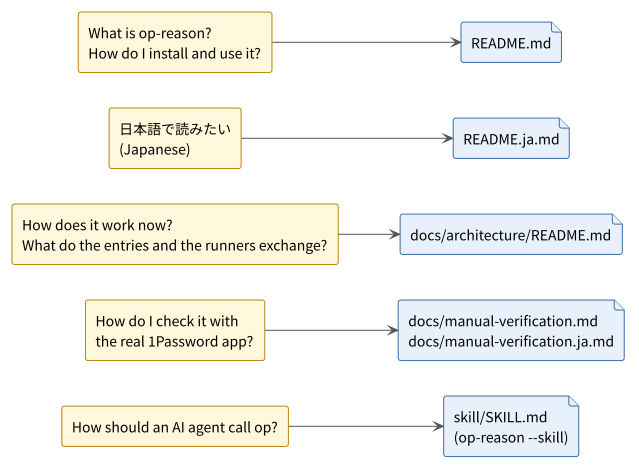

# op-reason documents

## Where to start

- [README.md](../README.md): what op-reason is, installation, usage, things to know
- [README.ja.md](../README.ja.md): the same in Japanese
- [architecture/README.md](architecture/README.md): how it works now, the launcher contract, the log format
- [manual-verification.md](manual-verification.md) / [manual-verification.ja.md](manual-verification.ja.md): checks
  with the real 1Password app
- [skill/SKILL.md](../skill/SKILL.md): the guide for AI agents (`op-reason --skill`)

## Diagrams

The diagrams are PlantUML (`plantuml/`, `architecture/plantuml/`) rendered to SVG in `out/`.
