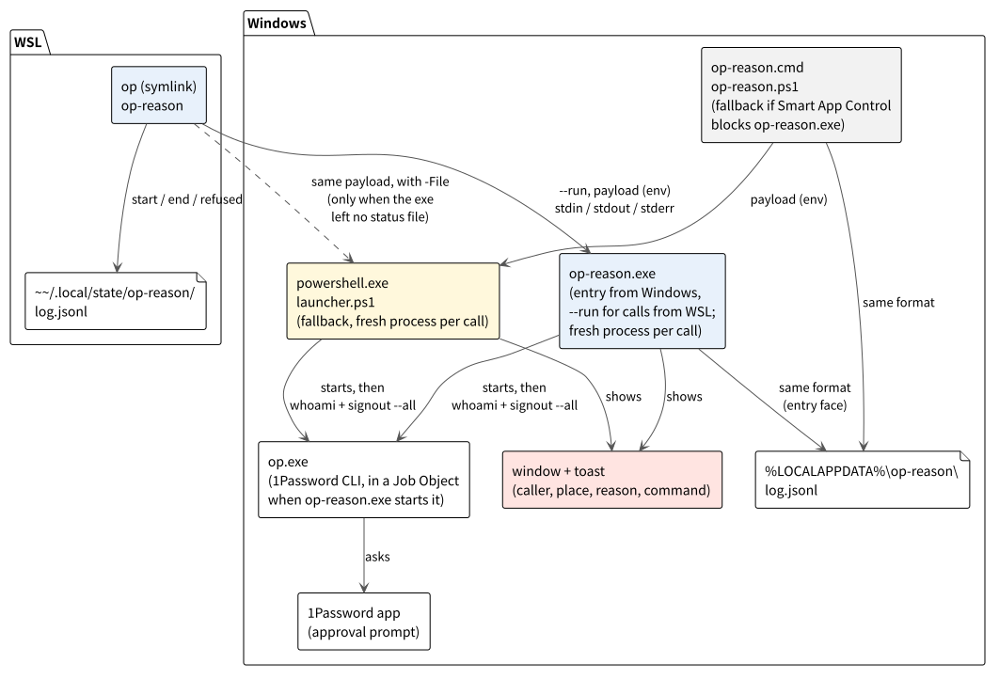

# How op-reason works

This page describes op-reason as it is now. Why it is built this way is in the design document
([docs/superpowers/specs/2026-11-15-op-reason-design.md](../superpowers/specs/2026-11-15-op-reason-design.md)).

## Parts

| Part | Where | Role |
| --- | --- | --- |
| WSL executable | `crates/op-reason/` | `op` / `op-reason`: the wrapper; `op-reason-log`: the log viewer. Linux only (`/proc`, flock, signals, `WSLENV`) |
| Core library | `crates/op-reason-core/` | argument planning, the launcher contract, log records and the log viewer, place detection, messages; builds for Windows too |
| Launcher | `launcher/launcher.ps1` | Windows PowerShell 5.1 script started fresh for every call: window, toast, `op.exe`, sign-out, status |
| Windows entry | `windows/` | `op-reason.ps1` (the entry) and `op-reason.cmd` (a shim for cmd.exe and other programs) |
| Fish completion | `completions/op.fish` | template printed by `op-reason --completion fish` |
| Skill | `skill/SKILL.md` | printed by `op-reason --skill` |
| Call table | `tests/cases/calls.json` | invocations and their expected plan, shared by the Rust tests and the Windows entry's tests |

## One call from WSL

1. **Plan** the arguments: the wrapper's own options, the reason (`--reason`, normalized), the mode (`desktop`, `help`,
   `service`), masking. No reason and not a help call → refused (exit 2).
2. **Collect** the caller: a `claude` ancestor in `/proc`, herdr workspace and pane, repository and branch read from the
   git files of the current directory, `CLAUDE_CODE_SESSION_ID`.
3. **Check** the tools (`op.exe`, `powershell.exe`, `wslpath`; exit 127) and the size (arguments travel in a Windows
   environment variable; exit 2).
4. **Pipes**: if another op-reason feeds stdin, read stdin to the end first.
5. **Lock** `<state>/lock` (flock), waiting up to `OPREASON_LOCK_WAIT` seconds (exit 75). While waiting: drain stdin if
   another op-reason starts feeding it; skip the lock if the holder reads our output. `<state>/current.json` names the
   holder.
6. **Watchdog**: `op.exe whoami` straight from WSL. Success means a shared approval: `signout --all`, log, notify.
   A call that skipped the lock leaves the watchdog to the lock holder. The payload is built and its size checked
   here, after the lock (exit 2 when it is over 32000 characters).
7. **Start** record, then the launcher: `powershell.exe -NoProfile -NonInteractive -ExecutionPolicy Bypass
   -OutputFormat Text -EncodedCommand <bootstrap>`, the launcher in `OPREASON_SCRIPT`, the payload in
   `OPREASON_PAYLOAD`. stdin and stdout are the caller's; stderr is relayed while its tail is kept.
8. **Result** from the status file, `op`'s exit code and `op`'s stderr; watchdog again; **end** record; exit with
   `op`'s code.

Signals (INT, TERM, HUP) log `interrupted` (an `end` after the start, a `refused` before it) and exit 130, 143, 129.
Children start with an empty signal mask, and a TERM or HUP to the wrapper alone is forwarded to the launcher, so the
window closes with the call.

## One call from Windows

1. **Arguments**: from PowerShell, PowerShell's arguments (`'--'` must be quoted); through `op-reason.cmd`, the entry
   splits the process command line itself (empty arguments and `--` survive).
2. **Plan** with the same rules as the core (the call table runs against both).
3. **Collect** the caller (Claude Code from `CLAUDECODE`/`CLAUDE_CODE_SESSION_ID`/`CLAUDE_PID`, Windows Terminal from
   `WT_SESSION`, the process chain, herdr), the place from git files, and log to `%LOCALAPPDATA%\op-reason\log.jsonl`
   (the same records; appends lock `log.lock`).
4. **Launcher**: a fresh `powershell.exe -File launcher.ps1` with the payload (`lock: held`, `lockWait` =
   `OPREASON_LOCK_WAIT`, `stderr: scan`). The launcher takes `Local\op-reason`, writes `holder.json`, relays `op.exe`'s
   stderr and reports a denial or timeout in `stderrMatch`. From PowerShell the launcher runs as a native command (output
   can be captured); through the shim it inherits the handles (binary-safe).
5. **Result** and **end** record; the entry puts its environment changes and the console encoding back, and exits with
   `op`'s code (75 and an `end` with `lock-timeout` when the mutex wait runs out).

There is no shared-approval watchdog on Windows (no shared parent process).

## The launcher contract

Entries (the WSL executable, the Windows entry, or an executable that replaces the Windows entry) and the launcher
agree on the following. Changing any of it is a contract change: update both sides, `tests/e2e.test.sh` and this
page.

### Environment

| Variable | Content |
| --- | --- |
| `OPREASON_PAYLOAD` | the payload JSON, ASCII only (`\u` escapes); removed by the launcher before `op.exe` starts |
| `OPREASON_SCRIPT` | WSL only: base64 of the UTF-8 launcher without byte order mark, comment lines and blank lines (< 30000 characters) |
| `WSLENV` | WSL only: the caller's value plus `OPREASON_SCRIPT:OPREASON_PAYLOAD`; service calls add `OP_SERVICE_ACCOUNT_TOKEN/w` or `OP_CONNECT_HOST/w:OP_CONNECT_TOKEN/w`, and `OP_BIOMETRIC_UNLOCK_ENABLED/w` (set to `false`) |

### Payload

| Field | Values |
| --- | --- |
| `v` | `1` |
| `mode` | `desktop`, `help`, `service`, `notify` |
| `op` | Windows path of `op.exe` |
| `args64` | `op`'s arguments, each UTF-8 then base64 |
| `status` | path for the status JSON |
| `lang` | `en`, `ja` |
| `lock` | `held` (take the Windows mutex) or `skipped` (do not, and do not sign out) |
| `lockWait` | seconds to wait for the mutex |
| `stderr` | `inherit`, or `scan` (the launcher relays `op.exe`'s stderr and reports `stderrMatch`; used by the Windows entry) |
| `facts` | desktop only: `time`, `caller` (`type`, `pid`, `session`, `detail`), `herdr` (`workspace`, `label`, `pane`) or null, `place` (`repo`, `branch`, `cwd`), `reason` (≤ 200 characters), `command` (masked, ≤ 300), `notes` (`shared-cleared`; `lock-skipped` with `holderReason`) |
| `notify` | notify only: `kind` (`shared-approval`), `when` (`start`, `end`), `cleared`, `time` |

The launcher builds every text of the window and the toast from `facts` and `notify`, in `lang`.

### Status (written by the launcher)

`started`, `exit`, `error` (`lock-timeout` when the mutex wait ran out), `window` and `toast` (`shown`, `skipped`,
`failed: …`), `others` (other `op.exe` seen), `signout` (`ok`, `not-signed-in`, `skipped`, `failed: …`), `lock` (`held`,
`skipped`, `timeout`), `holder` (one line, on a timeout), `stderrMatch` (`denied`, `timeout`; scan mode), `ui` (the
texts it built). The launcher exits with `op`'s code, 127 when `op.exe` is missing, 75 when the mutex wait runs out, 1
for other failures before `op.exe` starts, 0 for `notify`.

### Lock

- WSL: flock on `<state>/lock`.
- Windows: the named mutex `Local\op-reason`, taken by the launcher (desktop, help and service calls) unless `lock` is
  `skipped`, waiting up to `lockWait` seconds; `%LOCALAPPDATA%\op-reason\holder.json` names the holder (`time`,
  `caller`, `reason`, `command`, `pid`). A WSL call holds the flock and then the mutex; it passes what is left of its own
  wait as `lockWait`.

## Log

`${XDG_STATE_HOME:-~/.local/state}/op-reason/log.jsonl` on WSL (`%LOCALAPPDATA%\op-reason\log.jsonl` on Windows), one
JSON object per line, renamed to `log.1.jsonl` at 1 MiB. Appends take `log.lock`.

| `event` | Fields |
| --- | --- |
| `start` | `v`, `id`, `time`, `epoch`, `session`, `mode`, `kind` (`desktop`, `help`, `service-account`, `connect`), `lock` (`held`, `skipped`), `caller` (`type`, `claude_pid`, `herdr`, `cwd`, `repo`, `branch`), `reason` (≤ 500), `args` (masked) |
| `end` | `v`, `id`, `time`, `epoch`, `session`, `result` (`approved`, `ok`, `denied`, `timeout`, `failed`, `launcher-failed`, `interrupted`), `exit`, `seconds`, `window`, `toast`, `others`, `signout`, `watch` (`start`, `end`: `none`, `cleared`, `error` or null) |
| `refused` | `v`, `id`, `time`, `epoch`, `session`, `why` (`no-reason`, `too-long`, `lock-timeout`, `no-op-exe`, `no-powershell`, `no-wslpath`, `interrupted`), `caller`, `reason`, `args` |
| `shared-approval` | `v`, `id`, `time`, `epoch`, `when` (`start`, `end`), `cleared` |

A call's `start` and `end` share `id`. Denied and timed-out approvals are recognized from `op`'s own `[ERROR]` lines
(`authorization prompt dismissed`, `authoriz… timeout` / `timed out`).

## State directory

`<state>` = `${XDG_STATE_HOME:-~/.local/state}/op-reason/` (mode 0700): `log.jsonl`, `log.1.jsonl`, `log.lock`, `lock`,
`current.json` (while a call holds the lock), `run/<id>/status.json` (during a call; leftovers older than an hour are
removed). Drained stdin and the stderr tail stay in memory.

## Tests

| Test | What it covers |
| --- | --- |
| `cargo test --workspace` | the core (including the call table) and the WSL helpers |
| `tests/wrapper.test.sh` | the executable with fake `powershell.exe`, `op.exe`, `wslpath` and `herdr` |
| `tests/launcher.test.sh` | the launcher on PowerShell 7 for Linux with a fake `op` |
| `tests/e2e.test.sh` | the executable and the real launcher together |
| `tests/log.test.sh` | the log viewer |
| `tests/completion.test.sh` | the fish completion with the real fish |
| `tests/windows/entry-plan.test.ps1` | the call table against the Windows entry (Windows PowerShell 5.1 in CI, PowerShell 7 on Linux) |
| `tests/windows/launcher.test.ps1` | the launcher on Windows PowerShell 5.1 with a fake `op.exe` (arguments, binary stdin, the mutex, stderr scan, the window and its screenshots) |
| `tests/windows/entry.test.ps1` | `op-reason.ps1` and `op-reason.cmd` end to end on Windows PowerShell 5.1 |
| [manual-verification.md](../manual-verification.md) | checks with the real 1Password app (by hand) |
